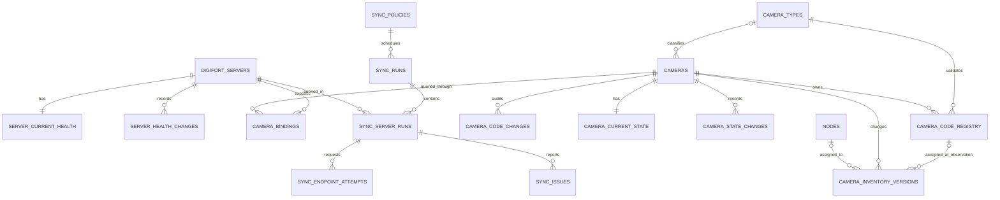

# Diseño de persistencia PostgreSQL — Etapa 3

**Estado:** el diseño completo distingue propuestas de implementaciones. La Fase 3A incorpora únicamente las siete tablas iniciales, con bloqueos conservadores para correcciones de identidad. El alcance físico, diferencias y validación están en [database-migrations.md](database-migrations.md). Los fragmentos SQL de este diseño no son la migración ejecutable.

## Alcance y decisiones principales

Propuesta para revisión, basada en `AGENTS.md`, `README.md`, `docs/digifort.md` y el código JSON actual (`json-types.ts`, `json-parser.ts`, `json-client.ts`, `config.ts`, `http.ts`, `errors.ts`). Este documento no crea tablas, migraciones, conexiones ni tareas periódicas. PostgreSQL y el frontend no se modifican.

Decisiones propuestas:

- Una cámara tiene UUID interno independiente del nombre, IP, servidor y nodo, y `camera_code` municipal único cuando su asignación está confirmada. El código completo incluye dígitos y letra; no sólo la parte numérica.
- `camera_code` es la identificación operativa municipal principal; `Name` exacto se conserva en vínculos temporales por servidor para unir GetCameras/GetStatus. Un ID nativo verificado podrá agregarse como dato técnico adicional, no sustituye el código municipal.
- Active, Working y grabación admiten desconocido. Disponibilidad del servidor, cobertura de consulta y antigüedad son dimensiones separadas.
- El último estado observado se conserva durante una falla; no se transforma automáticamente en falso ni se presenta como una observación reciente.
- Las consultas repetidas actualizan marcas de confirmación. El historial registra cambios semánticos, cambios de cobertura y cambios de inventario; no una copia completa por cámara cada minuto.
- Cada servidor se procesa y confirma de manera independiente. Las fallas parciales quedan visibles en las ejecuciones.
- Las credenciales se resuelven fuera de las tablas de infraestructura. No se almacenan respuestas remotas completas, URLs autenticadas ni errores originales.

Todos los nombres de entidades y campos siguientes son propuestas en inglés; los ejemplos son sintéticos y no contienen inventarios municipales. La identificación municipal y su unicidad completa fueron confirmadas por el usuario; las políticas de corrección, reserva histórica y aprobación que se detallan aquí son propuestas para Fase 3A.

## 1. Modelo de entidades y relaciones



Cardinalidad lógica: cada cámara y servidor recibe una fila de estado inicial `unknown` en la misma transacción de alta. Los vínculos, versiones y eventos referencian la ejecución que los originó cuando el origen es automático; los cambios manuales llevan actor lógico y motivo. Las referencias históricas a ejecuciones son opcionales para permitir su retención independiente.

### `nodes`

- PK `id: uuid`; `code: text` único y no vacío; `name: text` no vacío.
- `lifecycle: active | retired`, `created_at`, `updated_at`, `retired_at` opcional.
- Un nombre no es clave y puede repetirse. Retirar no elimina relaciones históricas.
- No derivar identidad del tercer octeto. Una tabla futura de fibra, enlaces o puertos queda fuera de este diseño inicial.

### `digifort_servers`

- PK `id: uuid`; `config_key: text` único, estable y no vacío, vinculado al `server.id` de configuración externa.
- `name`, `endpoint_origin` sin query, fragmento ni usuario/contraseña; `enabled`, `retired_at`, marcas de creación/modificación.
- `credential_ref: text` es un identificador opaco del proveedor externo de secretos; nunca contiene el secreto ni una URL de acceso firmada.
- `sync_policy_id` FK a política; `config_revision: bigint` positiva para invalidar resultados de una configuración anterior.
- No imponer unicidad de IP: puede cambiar o compartirse con puertos diferentes. Alertar duplicación de destinos activos para evitar doble ingestión.
- El origen es dato de infraestructura restringido; en desarrollo y Git sólo habrá configuración ficticia. Toda modificación de origen, etiqueta o política será auditable mediante un evento de configuración saneado; no guardar versiones de credenciales.

### `camera_types`

- PK `code: text`, una letra ASCII mayúscula; `name: text` no vacío, `enabled: boolean`, marcas de creación/modificación.
- Valores iniciales confirmados: D = Domo, F = Fija, P = Punto Seguro. El catálogo admite nuevas letras mediante alta administrativa auditada; no usar un enum cerrado F/D/P ni crear tipos automáticamente desde Description.
- No borrar ni cambiar una clave referenciada; deshabilitarla impide nuevas asignaciones, pero conserva códigos e historia anteriores. Cambiar la etiqueta visible no cambia el código.
- Una letra aún no registrada es un tipo desconocido, no una cámara descartable ni una equivalencia con F/D/P.

### `cameras`

- PK `id: uuid`, generada por la plataforma.
- `camera_number: text` nullable: secuencia de dígitos, incluidos ceros iniciales; nunca convertir a entero ni exigir unicidad numérica.
- `camera_type_code: text` nullable, FK a `camera_types.code`.
- `camera_code: text` nullable, calculado como `camera_number || camera_type_code`, con unicidad global sobre valores no nulos, también para cámaras retiradas. No incluye `)` ni texto descriptivo. Los componentes se asignan juntos o permanecen ambos NULL.
- `lifecycle: active | retired`, `identity_review: confirmed | provisional | disputed`, marcas de creación/retiro y `identity_revision` creciente para control de concurrencia.
- Los componentes representan un código **aceptado**, no cualquier candidato encontrado en Description. Permitir múltiples cámaras provisionales sin código (NULL) mantiene el monitoreo ante errores de datos; no usar un código inventado, cadena vacía o un valor común de desconocido.
- UUID sigue siendo la PK técnica; `camera_code` es clave operativa municipal única. No usar `Name`, IP, Description ni el actual `cameraId` numérico del conector como PK.
- Se elimina `asset_code` de esta propuesta: `camera_code` expresa la regla confirmada y evita dos identificadores operativos ambiguos. Un eventual número patrimonial distinto requerirá otro requisito explícito.
- Servidor, nodo, nombre y dirección actuales se obtienen de la versión de inventario abierta, no de columnas duplicadas sin control de coherencia.

### `camera_code_registry` y `camera_code_changes`

Registro de propiedad y auditoría del código, separado de su observación en Digifort.

- `camera_code_registry`: PK `camera_code: text`; FK `camera_id`; `camera_number`, FK `camera_type_code`; `first_assigned_at`, `last_confirmed_at`, origen y referencia a la aprobación. Integridad entre código y componentes, y UNIQUE `(camera_id, camera_code)` para referencias compuestas.
- Propuesta conservadora: cada código confirmado queda reservado al mismo UUID incluso después de una corrección o retiro. La propiedad del registro no se actualiza ni elimina por sincronización; un código antiguo no se reasigna automáticamente a otro dispositivo. No es una nueva regla municipal confirmada: debe aprobarse antes de Fase 3A.
- `cameras` referencia mediante `(id, camera_code)` al propietario de ese código en el registro. El registro también referencia la cámara: para un alta nueva, crear primero la cámara provisional sin código, reservar código y asignar componentes dentro de una única transacción.
- `camera_code_changes`: PK UUID, FK `camera_id`, `revision` única por cámara, `old_code` y `new_code` opcionales, timestamps, actor, motivo, aprobación y referencia a reconciliación. Al menos uno de los códigos no es NULL y deben ser diferentes con comparación nula-segura. Los códigos presentes referencian el registro del mismo UUID.
- Registrar alta, corrección, revocación y eventual restauración de un código reservado del mismo UUID. No actualizar los códigos antiguos de eventos ni mover observaciones entre cámaras como efecto de la corrección.
- Si el municipio necesita reutilizar un código en otro dispositivo, detener esa operación hasta definir propiedad temporal y cómo distinguir las generaciones; no eliminar la reserva para sortear UNIQUE.

### `camera_bindings`

Vínculo entre la cámara interna y su nombre técnico en un servidor durante un período. `external_name` relaciona las respuestas de GetCameras y GetStatus; no es el identificador municipal principal y puede cambiar sin cambiar `camera_code`.

- PK `id: uuid`; FK `camera_id`, FK `server_id`.
- `external_name: text` exacto, no vacío; `external_id: text` opcional, reservado a un identificador nativo cuya semántica se haya validado.
- `identity_generation: integer` positiva; distingue reutilizaciones de la misma clave externa.
- `valid_from`, `valid_to` opcional; `reason: discovered | renamed | moved | replaced | reconciled`; `identity_source`, `reviewed_by` opcional.
- Unicidad entre vínculos abiertos de `(server_id, external_name)`; equivalencia textual exacta, sin trim, conversión de mayúsculas ni colación insensible a caso.
- Unicidad entre vínculos abiertos de `(server_id, external_id)` cuando no sea nulo. Los identificadores se conservan como texto, incluidos ceros iniciales.
- Inicialmente un solo vínculo abierto por `camera_id`. Si hay réplicas legítimas en varios servidores, revisar esta regla antes de implementar; no fusionarlas implícitamente.
- `valid_to > valid_from` si se cierra; impedir períodos superpuestos para la misma identidad externa y para la cámara en este modelo de asignación única. La implementación deberá combinar restricciones temporales apropiadas con bloqueo transaccional.
- Un vínculo cerrado nunca se reabre para otro dispositivo. Una reasignación crea una generación nueva.

### `camera_inventory_versions`

Versiones del inventario y ubicación lógica. No representan cada observación idéntica.

- PK `id: uuid`; FK `camera_id`, FK `binding_id`, FK `node_id` opcional.
- `valid_from`, `valid_to`; `first_observed_at`, `last_confirmed_at`; `origin: digifort | manual | reconciliation`.
- `display_name` y `external_name` del vínculo mantienen separado el nombre técnico de la identificación municipal.
- `description_original` conserva el texto original de Description (o NULL si no se recibió), sin reemplazarlo por el código o la descripción recortada. `description_text` conserva el texto posterior al primer `)` que separa un prefijo válido; no partir por todos los paréntesis ni truncar el resto. Una variante recortada para presentación puede derivarse sin alterar el original.
- `code_candidate`, `number_candidate`, `type_code_candidate` y `code_parse_status: absent | invalid | unknown_type | valid` describen lo observado, independientemente del código confirmado de `cameras`. Guardar `code_parser_version` y `code_review_status: pending | accepted | conflict | rejected` con referencia opcional a incidencia/reconciliación; si existe código aceptado coincidente, su referencia al registro es opcional y verificable.
- Un candidato inválido puede quedar NULL mientras se conserva el original restringido; una letra desconocida con sintaxis válida conserva los componentes candidatos sin FK obligatoria al catálogo. Los candidatos pueden repetirse: no aplicarles UNIQUE que impida monitorear una cámara con código duplicado.
- `camera_code_at_observation` opcional referencia el código aceptado para ese UUID en aquel momento; no se recalcula retroactivamente al corregirlo.
- `legacy_camera_id` y `legacy_camera_type` opcionales conservan sólo la salida histórica del conector para trazabilidad; la parte numérica no representa el nuevo código completo. `model`, `device_type` y demás metadatos mantienen su significado.
- `connection_address: text` admite hostname o IP; `connection_ip: inet` opcional sólo si la dirección es IP válida; `connection_port` validado si se confirma su formato numérico.
- `latitude`, `longitude` numéricas opcionales con rangos geográficos, sólo tras conversión válida; `memo` y JSONB acotados/seleccionados para `media_profiles` y `camera_group`.
- Los valores escalares heterogéneos actuales se conservan en un `source_scalars` JSONB de claves permitidas cuando aún no se pueden normalizar sin pérdida. No copiar el objeto remoto completo.
- Una versión abierta por cámara. Un cambio de Description/candidato, código aceptado, nombre, vínculo/servidor, dirección o nodo cierra la versión y crea otra. Actualizar únicamente `last_confirmed_at` si el contenido semántico no cambia.
- FK compuesta o validación equivalente que garantice que `binding_id` pertenece al mismo `camera_id`; nunca asociar la versión de una cámara al vínculo de otra.
- Las asignaciones manuales de nodo tienen precedencia explícita y procedencia; la siguiente sincronización no debe borrarlas con un `nodeId: null` de contexto.

### `camera_current_state`

PK y FK `camera_id`; una fila por cámara. FK `binding_id` vigente y referencia opcional a la última ejecución aplicada.

| Grupo | Campos propuestos |
| --- | --- |
| Observación | `active: boolean NULL`, `working: boolean NULL`, `active_source: status \| inventory \| unknown` |
| Fuentes independientes | `inventory_active`, `status_active`: boolean nullable; conservar desacuerdos entre ambas fuentes, no sobrescribir una con la otra |
| Grabación | `configured_to_record`, `writing_to_disk`: boolean nullable; `recording_fps`, `recording_hours`, `recording_hours_estimative`, `used_disk_space` y tiempos de actividad: valores normalizados sólo con unidades confirmadas |
| Compatibilidad escalar | JSONB acotado `recording_source_scalars` para conservar valores originales seleccionados, sin convertir ausencias en ceros |
| Consulta | `last_attempt_at`, `last_snapshot_success_at`, `last_inventory_seen_at`, `last_status_seen_at` |
| Procedencia temporal | `active_observed_at`, `working_observed_at`, `recording_observed_at`; fecha del dato utilizado, no del último intento fallido |
| Presencia | `inventory_presence: unknown \| present \| missing \| retired`, `missing_since`, `consecutive_complete_inventory_misses` |
| Cobertura | `status_coverage: unknown \| matched \| missing`, `observation_epoch`, `last_applied_server_run_id`, `applied_sequence` |

`writing_to_disk` es el nombre interno; el mapeo de origen conserva explícitamente la grafía `WrittingToDisk`. Las unidades y conversiones todavía no verificadas no se deducen de los nombres de campos.

Restricciones: contador de ausencias no negativo; origen `unknown` implica Active nulo y los otros orígenes implican Active conocido; Active efectivo y procedencia deben coincidir con la prioridad `status_active` sobre `inventory_active`. Los timestamps de cada fuente se conservan por separado. Las observaciones conocidas requieren su timestamp. Una lectura válida que devuelve un campo desconocido guarda NULL y timestamp de valor conocido NULL; el valor conocido anterior permanece en el historial, no se inventa en el registro actual. `last_status_seen_at` puede avanzar si existe un registro de estado válido aunque sus flags sean nulos; eso no certifica que Working sea conocido.

La fila se actualiza sólo con observaciones aceptadas del vínculo vigente. Las fechas de intentos se actualizan sin renovar las fechas de observación. Falla de servidor no altera estos flags; su calidad efectiva se determina al consultar salud/cobertura/frescura.

### `camera_state_changes`

- PK `id: uuid`; FK `camera_id`, FK `binding_id`; `state_sequence` creciente por cámara, único con `camera_id`.
- `observed_at`, `recorded_at`, `last_confirmed_at`, `observation_epoch`; referencia opcional a ejecución.
- Estado posterior con Active, Working, valores de Active por fuente, origen de Active, `configured_to_record`, `writing_to_disk` y motivo `initial | state_changed | coverage_changed | resumed | binding_changed`.
- `status_coverage` y versión de reglas `normalization_version` para interpretar el evento.
- No guardar secretos, cuerpo remoto ni IP/Description duplicados en cada transición; se consulta la versión de inventario temporal.
- Es append-only para su contenido semántico; `last_confirmed_at` puede avanzar mientras se confirma el mismo estado dentro de la misma época. No reescribir eventos antiguos para corregir identidad sin una acción de reconciliación auditada.

### `server_current_health` y `server_health_changes`

La primera tiene PK/FK `server_id`; la segunda PK `id: uuid`, FK `server_id`, `health_sequence` único por servidor y estado posterior.

Campos: `transport_state: unknown | responding | unreachable`, `query_state: unknown | healthy | partial | auth_error | http_error | invalid_response | configuration_error | transport_error`, `last_attempt_at`, `last_response_at`, `last_success_at`, `last_inventory_success_at`, `last_status_success_at`, `consecutive_failures`, `observed_at`. Historial conserva secuencia, cambios semánticos, `first_observed_at` y `last_confirmed_at`, sin evento por cada error idéntico.

`unreachable` se reserva a fallas de conectividad suficientemente clasificadas; un 401/403 significa servidor que respondió con error de autenticación. Un timeout genérico o `NETWORK_ERROR` sin detalle suficiente no prueba por sí solo que todo el servidor sea inaccesible: registrar `transport_error` y no inventar diagnóstico de red. Si un endpoint responde y otro no, la salud de consulta es parcial. No derivar salud únicamente de un contador de cámaras.

### `sync_policies`

- PK `id: uuid`; `code` único; `enabled`, `interval_seconds` positivo (valor inicial propuesto: 60).
- `request_timeout_ms`, `max_response_bytes`, `max_concurrency`, `stale_after_seconds`, `missing_after_complete_runs`, `empty_inventory_requires_review`.
- Propuesta inicial: frescura de 180 segundos, ausencia confirmada tras 3 inventarios completos consecutivos y revisión ante inventario vacío. Son parámetros de operación a aprobar, no valores activos.
- Guardar una copia de parámetros no secretos de la política en cada ejecución para que los cambios no reinterpreten el pasado.

### `sync_runs`, `sync_server_runs`, `sync_endpoint_attempts`, `sync_issues`

| Entidad | Claves y contenido |
| --- | --- |
| `sync_runs` | PK UUID; FK política; `scheduled_for`, `started_at`, `finished_at`, `trigger: schedule \| manual \| recovery`; `outcome: running \| success \| partial \| failed \| cancelled \| abandoned`; total planificado, exitoso, parcial, fallido y omitido; clave única de planificación por política y slot |
| `sync_server_runs` | PK UUID; FK ejecución y servidor; UNIQUE `(run_id, server_id)`; secuencia por servidor, revisión de configuración y vínculo lógico de política; `started_at`, `finished_at`, outcome; contadores de inventario/estado, matched/missing/orphan; `inventory_completeness: unknown \| complete \| incomplete`; `applied_at`; lease y token de exclusión para el futuro worker |
| `sync_endpoint_attempts` | PK UUID; FK ejecución-servidor; `endpoint: cameras \| status`, `attempt_no`; UNIQUE `(server_run_id, endpoint, attempt_no)`; tiempos, HTTP status opcional, error tipado, bytes, filas y cobertura conocida; distingue éxito de red, parseo y aplicación |
| `sync_issues` | PK UUID; FK ejecución-servidor y endpoint opcional; FK cámara opcional cuando se resuelve inequívocamente; `code`, `stage`, `severity`, HTTP status opcional, `retryable`, `occurrence_count` y `message_key` de catálogo |

Los outcomes terminales requieren `finished_at >= started_at`; una ejecución running no tiene finished_at. Una ejecución de servidor sólo tiene `applied_at` si la transacción de datos se confirmó. No marcar éxito completo con discrepancias de cobertura; resultado técnico exitoso y cobertura completa son dimensiones distintas.

### `infrastructure_changes` e `identity_reconciliations`

Auditoría administrativa distinta de las observaciones automáticas. `infrastructure_changes` tiene PK UUID, tipo de entidad permitido, FK servidor/nodo/cámara con exactamente una referencia no nula, actor lógico, timestamp, motivo y diferencias de campos permitidos; prohíbe cambios de secretos o copias de configuraciones completas. Esas FK no permiten borrar el activo mientras la auditoría lo referencie.

`identity_reconciliations` tiene PK UUID, FK cámara candidata y cámara resuelta opcionales según la acción, vínculos anterior/nuevo, código anterior/propuesto y `action: assign_code | correct_code | revoke_code | restore_code | rename | move | replace | merge_proposal | reject`, actor, motivo, timestamps y decisión. Los códigos son referencias/candidatos revisados, no claves para mover eventos automáticamente; `expected_identity_revision` impide aprobar una propuesta sobre identidad ya modificada. Confirmar actualiza vínculos/versiones en una transacción; una propuesta no cambia identidad. Los motivos deben ser códigos y texto revisado sin secretos, nunca respuestas originales. Una fusión de historiales no se automatiza: requiere una operación específica posterior que preserve procedencia.

## 2. Identificación municipal y continuidad de identidad

### 2.1. Evidencia funcional y diferencias con la regla confirmada

Se inspeccionó en sólo lectura el `index.js` original externo, sin ejecutarlo ni copiarlo. Referencias: `DESC_REGEX` en línea 124; extracción de `descMatch`, `cameraId` y `typeLetter` en líneas 211–213; mapa de tipos en línea 123. El conector actual `json-parser.ts` replica esa extracción.

| Aspecto | Implementación de referencia y conector actual | Regla municipal confirmada / diseño actualizado |
| --- | --- | --- |
| Prefijo | `/^(\d{2,4})([FDP])\)/i` sobre Description con trim exterior | Dígitos seguidos de una letra y `)` como separador; el código no incluye el paréntesis |
| Dígitos | De 2 a 4, conservados como cadena | Secuencia textual, conservando ceros; no se confirmó un límite de 2–4 |
| Letras | Sólo F/D/P; acepta minúsculas y convierte letra a mayúscula | Catálogo extensible con D/F/P iniciales; otras letras requieren alta/revisión |
| `CameraId` / `cameraId` | Devuelve sólo el grupo numérico, no el código completo | `camera_code` concatena número y letra; dos tipos con el mismo número pueden ser cámaras diferentes |
| Tipo P | Etiqueta “Punto” | Etiqueta confirmada “Punto Seguro” |
| Resto de Description | Se conserva Description completa; no hay campo específico para el texto posterior al separador | Conservar original y derivar `description_text` sin perder el resto |
| No coincidencia | Usa un valor por defecto; no valida unicidad municipal | UUID provisional, candidato no aceptado e incidencia; monitoreo continúa |
| Asociación de estado | Mapa por Name exacto | Mantener esa asociación técnica; no sustituirla por el código de Description |

La existencia de código municipal queda confirmada por negocio; **no** se confirma que todos los registros actuales lo tengan correcto ni que los valores numéricos derivados hasta hoy sean únicos.

Ejemplos exclusivamente sintéticos: `0042F) Cámara de ensayo` identifica `0042F`, con número `0042`, tipo F y texto posterior ` Cámara de ensayo`. `0042D` es otro código válido y puede corresponder a otro UUID. El espacio inicial del texto posterior puede omitirse en presentación, sin alterar `description_original`.

Extracción futura propuesta a partir de esa misma convención, no de un formato alternativo: reconocer al inicio de una vista con trim exterior una secuencia no vacía de dígitos ASCII, una letra ASCII y el primer `)`, normalizar sólo la letra a mayúscula y validar contra el catálogo. La forma conceptual es `^([0-9]+)([A-Za-z])\)`; ampliar el límite de dígitos y letras respecto del legado responde a los requisitos confirmados, **todavía no modifica el parser**. Conservar el texto original y offsets para extraer el sufijo; no convertir el número a entero ni buscar códigos arbitrarios dentro de la descripción. El texto posterior puede estar vacío sin invalidar un código, salvo regla adicional futura.

`00042F` y `42F` no se colapsan en este diseño: se preserva el texto hasta que el municipio defina una equivalencia explícita. La extracción no agrega unicidad a los candidatos ni convierte una cadena mal formada en una clave válida.

### 2.2. Candidatos, conflictos e identidad provisional

Separar tres decisiones: unir inventario/estado por Name, extraer un candidato municipal, y aprobar su pertenencia a una cámara UUID. La aprobación de un código se realiza después de revisar el conjunto de observaciones del ciclo y contra los códigos reservados, no asignando al primer registro que llegue.

| Situación | Tratamiento propuesto |
| --- | --- |
| Código válido, conocido y sin colisión | Proponer asignación al UUID. En la primera carga, aprobación explícita o importación revisada; posteriormente mantener el código confirmado sin reasignarlo por cada lectura |
| Sin Description o vacía | `absent`; UUID/vínculo provisional, código aceptado NULL, monitoreo y estados conservados |
| Prefijo mal formado | `invalid`; conservar original restringido, emitir incidencia y no fabricar código |
| Sintaxis válida y letra no catalogada | `unknown_type`; conservar candidato, crear revisión de tipo; no mapearlo a un tipo conocido ni aceptar la asignación automáticamente |
| Mismo código en dos nombres o servidores | Incidencia de conflicto; conservar observaciones por sus UUID/vínculos separados; no fusionar ni elegir por orden de llegada |
| Name conocido con código observado distinto | Mantener UUID y código confirmado; registrar candidato conflictivo y revisión de corrección, sin mover historia al dueño del candidato |
| Candidato igual a código reservado de otra cámara o retirado | Bloquear asignación, mantener monitoreo provisional y exigir revisión; no liberar reservas automáticamente |
| Código inválido/ausente después de uno correcto | Conservar código confirmado; nueva versión de Description e incidencia, sin revocarlo por sincronización |

Para un nombre nuevo sin identidad resuelta se crea un UUID provisional y un vínculo técnico, con los tres campos de código aceptado NULL. Para un vínculo vigente se conserva su UUID aunque Description falle. Ningún error municipal modifica Active, Working, presencia de inventario o disponibilidad del servidor. El conjunto sigue ingresando; se marca resultado parcial por calidad de identificación, sin confundirlo con error de consulta.

Si el mismo Name cambia de dispositivo físico sin evidencia explícita, el conector no puede detectarlo por sí solo: abrir revisión ante indicios, y no afirmar continuidad física sólo por coincidencia de Name o código. La identidad provisional no es un mecanismo de fusión automática posterior.

### 2.3. Renombrados, movimientos y reemplazos

1. **Renombrado:** Name cambia pero el código confirmado coincide con una cámara existente. Generar una propuesta de continuidad; el código sirve como evidencia municipal principal, pero no autoriza reasociar un vínculo ocupado ni fusionar UUIDs automáticamente. Confirmada la operación, cerrar/abrir vínculo con el mismo UUID y código.
2. **Movimiento de servidor o nodo:** conservar UUID y código al confirmar que es la misma cámara. Versionar relación de servidor/nodo, cerrar el vínculo anterior cuando corresponda y obtener estado fresco del nuevo. No trasladar un Working reciente del servidor anterior como observación del nuevo vínculo.
3. **Código distinto en un vínculo vigente:** tratar como posible error de Description, corrección autorizada o reemplazo; no resolverlo automáticamente por IP, código o similitud de nombre.
4. **Reemplazo físico:** por defecto UUID nuevo y vínculo/generación nuevos. El código anterior queda reservado al UUID anterior, incluso retirado. Si el municipio conserva el mismo código operativo al sustituir hardware, hace falta decidir antes si el UUID representa el punto de monitoreo o el equipo físico, o introducir una entidad de instalación/dispositivo. No se fuerza un código duplicado ni se mezcla el historial mientras esa decisión esté pendiente.
5. **Código retirado que reaparece:** requiere revisión; puede ser el mismo activo reactivado, un reemplazo o una carga equivocada. No reabrir identidades cerradas automáticamente.

La política inicial mantiene un UUID por activo monitoreado con continuidad física confirmada; la continuidad de un código no equivale a prueba técnica de continuidad de hardware. Las observaciones de UUIDs provisionales permanecen en sus entidades de origen. Confirmar que dos entidades eran la misma requiere una reconciliación explícita, con procedencia y consulta conjunta auditable; nunca un UPDATE masivo de historia por coincidencia de códigos.

### 2.4. Corrección explícita de códigos sin pérdida de historia

Propuesta de operación administrativa, no disponible todavía:

1. Abrir revisión con UUID, código aceptado, candidato, motivo y revisión esperada de identidad. El código observado nunca sobrescribe por sí solo el aceptado.
2. Verificar evidencia, tipo catalogado, unicidad en `cameras` y propiedad en `camera_code_registry`, incluyendo reservas históricas. Si el código pertenece a otro UUID, detener y resolver el conflicto; no fusionar historiales para pasar la restricción.
3. Aprobar con actor autorizado. Bloquear la cámara y reservas afectadas, validar `identity_revision` y reservar el nuevo código para el mismo UUID en una transacción. Una carrera de asignación termina en conflicto controlado, no en descarte de la cámara.
4. Actualizar conjuntamente número y letra; el código completo se calcula. Crear `camera_code_changes`, reconciliación y versión de inventario, e incrementar revisión. El código previo permanece en el registro de ese UUID y en la auditoría.
5. Mantener estados, vínculos y eventos ligados al UUID; no cambiar retrospectivamente Description ni etiquetas históricas. Consultas históricas muestran el código vigente en su momento y, cuando corresponde, su equivalencia auditada con el actual.
6. Revocar un código erróneo deja componentes NULL y cámara provisional o disputed, sin borrar observaciones. Restaurar un código reservado al mismo UUID es otra acción auditada; no borrar el cambio anterior.

Los cambios entre letras también son correcciones de código completo: no asumir que dos cámaras comparten identidad por tener los mismos dígitos. Una confirmación administrativa puede corregir un error de tipificación del mismo activo, pero nunca fusiona otro UUID por efecto secundario.

## 3. Semántica de estado, calidad y frescura

Cada flag utiliza boolean nullable: TRUE observado, FALSE observado, NULL desconocido. No hay default FALSE. Mantener procedencia de Active cuando el conector usa fallback de inventario; no asumir que ese dato tiene la misma semántica que Active de estado.

| Situación | Tratamiento |
| --- | --- |
| Active verdadero y Working falso, con cobertura y frescura válidas | Cámara observada como caída; no significa servidor inaccesible |
| Active falso y Working conocido o desconocido | Cámara inactiva; conservar Working independiente |
| Flag nulo | `NULL`: sin observación; no se cuenta como falso |
| Último Working falso pero dato vencido | Último valor conocido falso, condición actual no confirmada |
| Servidor con falla de consulta | Cambia salud del servidor; conserva última observación de cámara y marca calidad efectiva degradada |
| Estado no presente en un snapshot válido | Cobertura missing, Working y grabación desconocidos; Active puede venir de inventario con su procedencia |
| Cámara no presente en inventario completo | Cambia presencia, no implica falla de cámara |

Propuesta de proyección: exponer `observed_state`, `observed_at`, `age_seconds`, `freshness: never_seen | fresh | stale` y motivos separados de degradación (`server_query_failed`, `missing_status`, `inventory_missing`, `binding_changed`). No construir un único enum que pierda dimensiones. La clasificación operacional de caída requiere además del par de flags cobertura de estado coincidente, presencia vigente y datos dentro del umbral; el origen de Active debe ser visible y su aceptación como fallback requiere decisión operativa.

La edad se calcula respecto del reloj de consulta y el timestamp del campo/fuente, no mediante una columna que sólo se actualiza cada minuto. Cambiar el umbral modifica la proyección futura; no reescribe flags ni transiciones históricas. Los períodos de indisponibilidad y de falta de cobertura deben mostrarse al reconstruir una línea de tiempo.

Todas las fechas son `timestamptz`, interpretadas en UTC; la UI podrá convertirlas a hora local. `observed_at` representa recepción de una respuesta válida y `recorded_at` el registro en la plataforma, no el instante exacto del cambio físico. Si en el futuro hay fecha de origen, almacenarla aparte con su confiabilidad. Usar tiempos monotónicos para duraciones de transporte; no restar relojes de servidores distintos sin garantías.

## 4. Historial sin duplicación y conservación de métricas

Separar cambios discretos, inventario, salud y métricas continuas:

- Comparar la tupla semántica `(active, working, inventory_active, status_active, active_source, configured_to_record, writing_to_disk, status_coverage, binding_id, observation_epoch, normalization_version)` con comparación nula-segura. Sólo insertar evento si cambia, es inicial o se reanuda una época; NULL a FALSE es una transición real.
- Una observación idéntica actualiza el estado actual, timestamps de confirmación y `last_confirmed_at` del evento abierto, sin crear otra transición.
- Un cambio de texto, IP o nodo genera versión de inventario, no una transición de Working ficticia.
- No incluir ActiveTime, InactiveTime, FPS o espacio de disco en la clave de transición: pueden variar en cada consulta aunque el estado no cambie.
- Conservar todas las últimas métricas de grabación en el estado actual. Si se requiere historia de estas métricas, proponer una tabla adicional `camera_metric_samples` con PK `(camera_id, bucket_start)` y resúmenes de un intervalo; no crear ahora un historial de muestras crudas a 60 segundos.
- El resumen de métricas debe distinguir cero, desconocido, cantidad de muestras y unidades/versiones; no sumar valores acumulativos como si fueran incrementos.

`observation_epoch` cambia cuando se observa una pérdida/reanudación de cobertura o un cambio de vínculo. Las fallas generales se registran una vez por servidor; al volver, el proceso reconoce la interrupción desde sus ejecuciones/salud e inicia época nueva aunque los flags coincidan. No se generan miles de eventos de cámara cada minuto por un servidor caído.

`last_confirmed_at` no prueba funcionamiento ininterrumpido entre observaciones. Un evento indica lo observado hasta otra observación o un límite de cobertura; la historia no debe interpolar a través de una interrupción o de datos vencidos. La aplicación de eventos y avance de secuencia ocurre en la misma transacción que la fila actual.

## 5. Desaparición temporal del inventario

- Sólo un inventario válido y **confirmado completo** puede aumentar el contador de ausencias. Timeout, endpoint fallido, respuesta parcial, paginación desconocida o identidad ambigua no lo aumentan.
- Primera ausencia: `inventory_presence=missing`, `missing_since` y contador uno; conservar cámara, vínculo e historial. No completar Active o Working con FALSE.
- Propuesta: tras 3 inventarios completos consecutivos, confirmar condición de ausente y abrir incidencia, sin eliminación ni retiro automático. Hasta ese umbral la ausencia es provisional; el contador y una incidencia distinguen ambas situaciones.
- Reaparición en el vínculo vigente: presencia present, contador cero, cerrar incidencia de ausencia y establecer nueva cobertura/época según las observaciones recibidas.
- Retirar exige política aprobada o intervención explícita; jamás cascade/delete por ausencia temporal.
- Un inventario vacío puede ser real, pero inicialmente requiere revisión antes de marcar todas las cámaras ausentes. El conector acepta `[]`, pero no acredita por sí solo que represente inventario completo autorizado.
- Los estados huérfanos se cuentan en la ejecución y generan incidencia saneada; no crean cámaras ni cambian el inventario. Un resultado nuevo y ambiguo no debe reutilizar identidades retiradas. Un error de código en Description no es ausencia de inventario: actualizar su presencia y continuar el monitoreo, conservando la identidad provisional o confirmada según corresponda.

La confirmación de completitud es un requisito nuevo: el snapshot actual no proporciona esa garantía. Mientras sea unknown, se puede actualizar lo visto, pero no inferir ausencias de lo no visto.

## 6. Ejecuciones, fallas parciales e idempotencia

Un ciclo global crea una ejecución y una fila de servidor por cada destino habilitado planificado. Los destinos deshabilitados se excluyen explícitamente; cancelados u omitidos se contabilizan y no figuran como éxitos. Si algunos servidores aplican datos y otros fallan, resultado global partial; si ninguno aplica y hubo fallas, failed. Cero servidores planificados debe registrarse como ejecución sin trabajo, no como prueba de salud de infraestructura.

Primera política propuesta, alineada al conector actual: **aplicación atómica por servidor**. Si falla GetCameras o GetStatus, no aplicar un snapshot parcial; registrar el endpoint fallido, las respuestas exitosas conocidas y el resultado fallido del servidor. Los demás servidores continúan. Si ambos responden pero hay estados faltantes/huérfanos, aplicar el inventario asociado y estados explícitamente desconocidos, con resultado partial y contadores de cobertura. Los errores de identificación municipal se registran por cámara y permiten confirmar las demás observaciones del servidor, incluidas las provisionales; no descartar el lote por un código inválido o duplicado. Sí siguen impidiendo asociación segura los nombres técnicos duplicados que rechaza el conector.

No se propone todavía aplicar inventario exitoso cuando falló estado. Si se decide hacerlo después, debe tener timestamps y reglas por fuente, sin renovar Working desde una consulta de inventario. Evitar transacciones globales que reviertan los servidores sanos.

Flujo futuro por servidor:

1. Reservar un intento con secuencia y lease/token de exclusión; fijar revisión de configuración y política.
2. Realizar consultas y validaciones fuera de la transacción de escritura; capturar tiempos por endpoint y resultado saneado.
3. Abrir transacción corta, bloquear estado de ingestión del servidor y verificar lease, revisión y secuencia. Descartar datos atrasados, intentos supersedidos o de vínculos cerrados.
4. Resolver identidades, actualizar versiones/estado, insertar sólo cambios necesarios y cerrar resultado aplicado en una transacción. Cada evento y fila actual referencia el mismo intento aplicado.
5. Si falla la escritura, hacer rollback y registrar fallo de persistencia en una transacción independiente cuando la base vuelva a estar disponible. No marcar éxito por haber obtenido HTTP 200.

UNIQUE `(run_id, server_id)`, secuencia por servidor, secuencia de evento por cámara y marcador `applied_at` evitan reaplicar un mismo resultado. Reintentar HTTP añade `attempt_no` bajo la misma ejecución-servidor; reintentar la aplicación ya confirmada no genera versiones ni eventos nuevos. Una comparación de valores por sí sola no es suficiente frente a resultados fuera de orden.

Si el worker cae, recuperar leases vencidos y marcar ejecuciones running antiguas como abandoned antes de reprogramar. El token de exclusión debe impedir que el worker antiguo publique al retomar. Si PostgreSQL está caído, no puede garantizarse registrar allí el propio fallo: sólo un diagnóstico externo saneado y la recuperación posterior pueden cubrir ese hueco; no prometer historial completo durante una caída de la base.

## 7. Intervalo de 60 segundos y antigüedad

La política comienza conceptualmente en 60 segundos y será configurable por servidor mediante su política. Todavía no se implementa scheduler. El intervalo no reemplaza timeout ni frescura.

- Evitar solapamiento de consultas para un mismo servidor. Si un ciclo demora más que el intervalo, registrar slots omitidos o retraso y tomar el siguiente slot disponible; no acumular consultas indefinidamente.
- Limitar concurrencia global, añadir dispersión de inicio y backoff acotado ante fallas, manteniendo visible el intervalo efectivo. No consultar más rápido por reintentos ilimitados.
- Una pausa o deshabilitación no vuelve fresh la última observación; se mantiene la edad y un motivo administrativo distinto de inaccesible.
- Guardar `scheduled_for`, inicio real, fin y política efectiva para medir retrasos y duración; los porcentajes operativos mostrarán cobertura sobre destinos/cámaras esperados.
- Propuesta inicial `stale_after_seconds=180`, configurable. El registro de la última consulta exitosa por servidor y por fuente permite detectar antigüedad aunque no se produzcan nuevas transiciones.

## 8. Índices, integridad y retención

Índices propuestos, a ajustar con volumen y consultas reales:

| Tabla/consulta | Índice o restricción |
| --- | --- |
| Código municipal aceptado | UNIQUE global `cameras(camera_code)`, incluyendo retiradas; múltiples NULL para provisionales |
| Reserva de códigos | PK `camera_code_registry(camera_code)`, UNIQUE `(camera_id, camera_code)` y FK de propiedad; sin reasignación de dueño |
| Historia de correcciones | UNIQUE `(camera_id, revision)` y `(camera_id, recorded_at DESC)` |
| Vínculo abierto por servidor/Name | UNIQUE parcial `(server_id, external_name)` donde `valid_to` es nulo, con igualdad textual exacta |
| Vínculo abierto por ID nativo | UNIQUE parcial `(server_id, external_id)` para ID no nulo y vínculo abierto |
| Cámara y versión actual | UNIQUE parcial por `camera_id` para cada vínculo/versión abierta; índices de FK `binding_id`, `node_id` |
| Historia de una cámara | `(camera_id, observed_at DESC, state_sequence DESC)` |
| Inventario por nodo | `(node_id, camera_id)` sobre versiones abiertas |
| Servidores y cámaras vigentes | `(server_id, camera_id)` en vínculos abiertos |
| Ejecuciones recientes | `(started_at DESC)` global; `(server_id, started_at DESC)` para ejecuciones de servidor |
| Problemas operativos | `(server_run_id, severity)`, `(code, created_at DESC)`; las incidencias incluyen `created_at` |
| Frescura | Timestamp de última observación/éxito según consulta; evaluar índices sobre Working falso conocido si son útiles |
| Retención por fecha | Índices de fecha y futura partición temporal en tablas de mayor volumen |

### Restricciones SQL propuestas para Fase 3A

Fragmentos ilustrativos de definición de columnas/restricciones, **no migraciones ni instrucciones ejecutadas**. `cameras.id` sigue siendo UUID PRIMARY KEY. La PK del catálogo es `camera_types.code`, con `CHECK (code ~ '^[A-Z]$')`. La etiqueta del tipo no es parte de la clave.

```sql
-- Proposed cameras columns and constraints, not executable migration code.
camera_number text,
camera_type_code text REFERENCES camera_types(code),
camera_code text GENERATED ALWAYS AS
  (camera_number || camera_type_code) STORED,
CONSTRAINT cameras_code_components CHECK (
  (camera_number IS NULL AND camera_type_code IS NULL)
  OR (camera_number IS NOT NULL AND camera_type_code IS NOT NULL
      AND camera_number ~ '^[0-9]+$')
),
CONSTRAINT cameras_camera_code_unique UNIQUE (camera_code),
CONSTRAINT cameras_code_owner FOREIGN KEY (id, camera_code)
  REFERENCES camera_code_registry(camera_id, camera_code)
```

La FK compuesta sólo exige propiedad cuando hay código; ambos componentes municipales NULL son el estado provisional permitido. La unicidad ordinaria de valores no nulos permite varias cámaras sin código; no usar una unicidad que considere todos los NULL como un único valor. No agregar UNIQUE a `camera_number` ni al candidato extraído. La letra se valida por FK; no fijar CHECK de pertenencia a F/D/P que impida ampliar catálogo.

```sql
-- Proposed camera_code_registry constraints; owner is never reassigned.
PRIMARY KEY (camera_code),
UNIQUE (camera_id, camera_code),
FOREIGN KEY (camera_id) REFERENCES cameras(id),
FOREIGN KEY (camera_type_code) REFERENCES camera_types(code),
CHECK (camera_number ~ '^[0-9]+$'),
CHECK (camera_code = camera_number || camera_type_code)
```

En el registro, `camera_id`, `camera_number` y `camera_type_code` son NOT NULL; `camera_code` lo es por ser PK. Las FK usan política de no borrado en cascada. `camera_code_changes` usa FK compuestas `(camera_id, old_code)` y `(camera_id, new_code)` al registro y `CHECK (old_code IS DISTINCT FROM new_code)`, con timestamps/actor/motivo obligatorios. Una inserción inicial permite old_code NULL; una revocación permite new_code NULL. El CHECK rechaza ambos NULL.

La protección de propiedad histórica, inmutabilidad del registro, revisión y creación de auditoría requiere una operación transaccional con permisos restringidos y validaciones/trigger a definir: CHECK y UNIQUE solos no impiden que un UPDATE administrativo reescriba el dueño de una reserva. El catálogo se deshabilita sin borrar tipos usados; la política de nuevas asignaciones a un tipo deshabilitado se verifica en esa operación. Todas las restricciones admiten que candidatos conflictivos existan en inventario sin pasar a `cameras`.

No crear un índice parcial con una condición que dependa de la hora actual para `stale`: la hora avanza aunque no se actualice la fila. Consultar por timestamps con un corte de tiempo explícito. No indexar indiscriminadamente todos los JSONB.

Todas las FK operativas impiden referencias inexistentes; para infraestructura e historia no usar borrado en cascada. Retiro lógico, no eliminación física automática. Las referencias de eventos/versiones a ejecuciones se pueden poner en NULL al purgar ejecuciones, conservando timestamps, secuencia y procedencia no secreta. No eliminar vínculos o versiones todavía necesarios para interpretar historia retenida.

Propuesta de retención **pendiente de aprobación municipal**, no normativa legal:

- Estados actuales, identidades y vínculos: conservar mientras exista el activo o historia que los referencie. Las reservas de códigos y su auditoría no expiran con las observaciones: mantenerlas para impedir reasignación silenciosa y conservar equivalencias de correcciones, incluso tras el retiro. Un cambio de esa retención requiere revisar la política de reutilización.
- Transiciones de cámara/servidor y cambios de inventario: 12 meses en línea como punto de partida; ampliar o archivar según necesidades de mantenimiento y auditoría.
- Ejecuciones, intentos e incidencias detalladas: 90 días; antes de purgar, agregar disponibilidad/cobertura diaria durante 12 meses o el plazo acordado.
- Si se habilitan métricas: muestras agregadas cortas por 30 días, resúmenes horarios/diarios por 12 meses; definir unidades y reglas antes.
- Mantener el último evento y versión anteriores al corte por cada cámara/servidor como punto de partida, incluso si son anteriores al plazo. Preservar el período que cruza el corte y reconciliaciones necesarias; un estado abierto hace un año no puede desaparecer por una purga simple por fecha.
- Ejecutar purga por lotes y medir impacto. Particionar sólo con evidencia de volumen y diseñar restricciones/retención de FK antes de activar particiones; no imponer complejidad prematura.
- Backups y archivos tienen política propia de expiración y acceso; purgar tablas no borra automáticamente copias históricas.

No se fija capacidad sin cantidad de cámaras, servidores ni tasa de cambios. A 60 segundos hay 1440 oportunidades de consulta por día y servidor; eso justifica guardar ejecuciones por servidor y transiciones por cambio, evitando multiplicar observaciones idénticas por cada cámara. Dimensionar con datos de prueba antes de elegir particiones.

## 9. Seguridad y catálogo de errores

Infraestructura y observaciones contienen información operativa restringida aunque no sean credenciales. Separar permisos de lectura de inventario, ingestión y administración; no preparar exposición pública como parte de esta etapa. Docker Compose sigue siendo la entrada local.

Guardar en PostgreSQL sólo `credential_ref`; username, password, tokens y material TLS privado pertenecen al proveedor de secretos externo. La configuración actual mezcla infraestructura y credenciales en memoria: el futuro adaptador de persistencia debe separarlas al guardar y reunirlas sólo al crear el cliente HTTP. No persistir ni serializar `DigifortServerConfig` completo.

Incidencias usan códigos permitidos del conector (`CONFIGURATION`, `HTTP_ERROR`, `NETWORK_ERROR`, `TIMEOUT`, `RESPONSE_TOO_LARGE`, `INVALID_JSON`, `INVALID_RESPONSE`, `DUPLICATE_NAME`) y códigos internos controlados (`PERSISTENCE_FAILED`, `INCOMPLETE_COVERAGE`, `IDENTITY_CONFLICT`, `WORKER_ABANDONED`, `STALE_RESULT_DISCARDED`, `CAMERA_CODE_ABSENT`, `CAMERA_CODE_INVALID`, `CAMERA_TYPE_UNKNOWN`, `CAMERA_CODE_CONFLICT`, `CAMERA_CODE_REVIEW_REQUIRED`). No guardar `error.message`, stack, cause, URL, headers, query, Name ni cuerpo original. El texto para usuarios se genera mediante catálogo y parámetros numéricos/UUIDs internos permitidos.

Los DTOs permitidos tampoco son automáticamente inocuos: Memo, Description, Group o perfiles podrían contener URLs o textos privados. Antes de persistir, aplicar una política de selección y saneamiento que excluya credenciales, userinfo, queries autenticadas y campos no aprobados; si no se puede sanear con certeza, omitir el campo y registrar código de redacción, nunca su contenido. `description_original` significa copia exacta del texto permitido en almacenamiento operativo restringido, no permiso para guardar secretos: si contiene material prohibido se omite o se conserva una versión redactada con `description_redacted=true`, sin presentarla como original íntegro. Un conflicto de redacción no elimina la cámara ni sus estados; el candidato municipal permitido puede mantenerse y revisarse independientemente. El texto original y su sufijo no se usan en mensajes de error ni fixtures de producción. No usar JSONB como depósito de respuestas completas. Revisar esta política con fixtures sintéticas de redacción.

## 10. Brechas del conector actual y preguntas pendientes

El diseño no asume capacidades que todavía no implementa el módulo:

- `getCameras()` devuelve un snapshot combinado y rechaza si falla cualquiera de los endpoints. No expone al llamador los resultados exitosos de cada endpoint, timestamps ni clasificación fina de fallas de transporte. Para completar `sync_endpoint_attempts` se necesitará instrumentación tipada futura, sin datos privados.
- `coverage` contiene contadores, pero no garantía de inventario completo/paginación ni estados huérfanos identificados. La persistencia debe abstenerse de inferir ausencias mientras no tenga evidencia de completitud.
- No hay identificador nativo confirmado, timestamps de origen ni garantía de estabilidad de Name. Sí está confirmada la regla municipal de código completo, pero `cameraId` del conector aún contiene sólo dígitos y sus tipos están cerrados a F/D/P. No persistir ese campo como `camera_code`; será necesario adaptar la extracción y DTOs en una tarea posterior, con fixtures sintéticas. Conservar identidad provisional hasta aprobar cada asignación.
- `nodeId` de contexto se aplica a todas las cámaras; no sirve como fuente autoritativa para servidores con varios nodos.

### Contradicciones corregidas respecto del diseño anterior

- `asset_code` era opcional y su unicidad quedaba sin confirmar. Se reemplaza por `camera_code` operativo cuya unicidad **completa y global** ya está confirmada; sólo puede faltar en una cámara provisional/no resuelta.
- El código se describía únicamente como un fragmento editable sin distinguir valor numérico y código completo. Ahora se separan el campo legado numérico, el candidato observado y el código municipal aprobado con letra.
- La advertencia contra usar códigos de Description para identidad no debe negar la identificación municipal existente. Se conserva como protección contra fusiones automáticas: el código confirmado es principal para operación; UUID y reconciliación protegen la continuidad del historial.
- La continuidad y reemplazos se trataban sin una reserva municipal. Ahora una corrección mantiene UUID y reserva anterior; un reemplazo con el mismo código queda expresamente pendiente de política física/lógica, no se permite duplicarlo ni heredar historial silenciosamente.
- El tipo cerrado y la etiqueta P de la referencia no reflejan el catálogo requerido. El diseño usa catálogo extensible y “Punto Seguro”; el código ejecutable todavía conserva su comportamiento previo.

### Decisiones pendientes antes de Fase 3A

La forma general del código, los tipos D/F/P y la unicidad del código completo **no están pendientes**. Sí se deben resolver estas políticas de aplicación:

1. ¿Se aprueba la reserva histórica sin reasignación de códigos? Si el mismo código se conserva al cambiar hardware, ¿representa un punto de monitoreo o un equipo físico? Definir entidad de instalación/dispositivo o propiedad temporal antes de permitir reutilización.
2. ¿Quién aprueba asignaciones iniciales, correcciones, revocaciones, nuevos tipos y reconciliaciones? ¿Se exige segunda aprobación en conflicto y cómo se revisará la primera carga municipal?
3. ¿Hay equivalencia administrativa entre dígitos con/sin ceros iniciales, límite máximo o longitud normativa? Hasta resolverlo conservar texto sin colapsar ceros ni heredar el límite de 2–4 del legado. Se propone aceptar mayúsculas/minúsculas como la referencia y guardar letra canónica mayúscula.
4. ¿Se permiten réplicas simultáneas de una cámara en distintos servidores? El diseño inicial de vínculo único exige revisar esa situación sin crear dos dueños del mismo código.

Otras preguntas operativas del diseño anterior que siguen vigentes:

1. ¿Existe ID nativo compartido por ambos endpoints como evidencia técnica adicional de continuidad física? No reemplaza el código municipal confirmado.
2. ¿Quién confirma renombrados, reemplazos y movimientos? ¿Se requiere una bandeja de reconciliación y auditoría de actor autenticado desde la primera versión?
3. ¿Cómo se acredita inventario completo, paginación y lista vacía legítima? ¿Se aprueban tres ausencias consecutivas y revisión del vacío masivo?
4. ¿Active de inventario puede usarse operacionalmente igual que Active de estado? ¿Qué significa cada bandera de grabación y cuáles son las unidades/tipos efectivos de sus métricas?
5. ¿Se acepta frescura inicial de 180 segundos? ¿Qué alertas requieren un único muestreo o persistencia temporal para evitar oscilaciones?
6. ¿Cuál es la fuente autorizada de asignación de nodos y el tratamiento de cambios manuales frente a datos importados?
7. ¿Qué metadatos libres se pueden almacenar y qué reglas de redacción se aprobarán? ¿Dónde se resolverán secretos, rotación y permisos de consulta de sólo lectura?
8. ¿Qué volumen, concurrencia, retención, ventanas de mantenimiento y requisitos de recuperación/archivo se necesitan? ¿Se aprueba retención distinta para incidentes y transiciones?
9. ¿La primera ingestión seguirá siendo atómica por servidor o se autorizará aplicar inventario cuando falle estado? El diseño inicial propone atomicidad para evitar ambigüedad.

## 11. Validación prevista para la implementación futura

Matriz documental de identificación a convertir en pruebas de Fase 3A; todos los valores son sintéticos:

| Caso | Resultado esperado |
| --- | --- |
| `0042F) Cámara de ensayo` y `0042D) Otra cámara de ensayo` | Dos códigos completos distintos admitidos; dígitos como texto |
| `00042F)` frente a `42F)` | No colapsar ceros; conservar original y sufijo vacío válido según propuesta |
| `0042f)` | Misma letra canónica F, original intacto; colisión si se intenta asignar a otro UUID |
| Una o cinco cifras con F | Reconocer la diferencia con regex legado de 2–4; validar la política ampliada antes de modificar código |
| `0042X)` con X ausente del catálogo | Candidato preservado, revisión de tipo y cámara provisional monitoreada |
| Description ausente, vacía, sin `)` o con texto antes del código | Sin código aceptado nuevo; incidente sin pérdida de monitoreo |
| Código repetido en el lote o reservado por otro UUID | Conflicto sin elegir ganador por orden, sin rechazo de observaciones ni fusión |
| Código distinto/ausente en Name ya vinculado | Conservar código confirmado; nueva versión y revisión |
| Corrección aprobada de un código libre | Mismo UUID, nueva reserva y auditoría; historial anterior intacto |
| Corrección a código de otro UUID o carrera de asignación | Transacción bloqueada/controlada, observaciones preservadas y revisión |
| Renombrado o movimiento con código confirmado | Propuesta de continuidad y cambio de vínculo aprobado, no fusión automática |
| Reemplazo con código reservado | Bloquear reasignación hasta política aprobada de instalación/dispositivo |
| Texto posterior con otro `)` | Conservar todo el sufijo, sin truncarlo |

No se implementan estos casos ni cambios del conector en esta entrega documental. Antes de activar sincronización, probar además con datos sintéticos: tres estados por flag; fallo de servidor sin modificar Working; repetición idempotente; NULL a FALSE; reanudación después de hueco; muestras atrasadas; Name duplicado/reutilizado; renombrado, reemplazo y cambio de servidor; cambio de nodo e IP sin cambio de UUID confirmado; ausencia sólo ante inventario completo; recuperación tras tres ausencias; rollback por servidor; fallas parciales entre servidores; lease vencido; retención que preserve un estado abierto y el punto de partida histórico; redacción de metadatos y errores.

Esta entrega es únicamente documental. No se implementaron migraciones, tablas, scheduler, conexiones a Digifort ni modificaciones de servicios.
